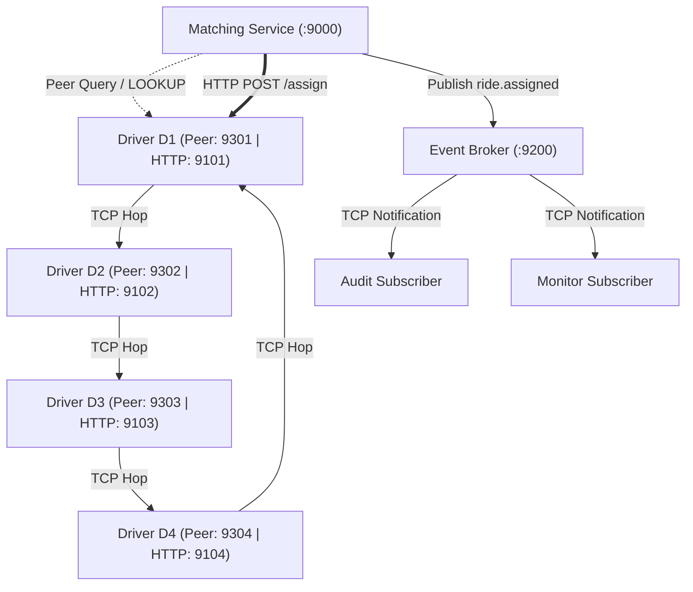

# CECS 327 - Distributed Ride-Matching System
**Milestone 3: Peer-to-Peer Overlay Network & Driver Discovery**

This milestone implements a distributed, successor-routed TCP peer-to-peer ring overlay connecting driver nodes (D1–D4). The centralized matching coordinator discovers available drivers dynamically by routing lookup queries through the peer ring rather than querying a static local registry. Request-reply HTTP interactions, JSON marshalling, pub-sub event notifications, and multicast group alerts from Milestone 2 remain fully integrated.

---

## 1. Required Software
* **Python 3.10+** (Tested on Python 3.14+)
* **Visual Studio Code** (or any code editor / terminal emulator)
* **PowerShell** (Windows) or **Terminal** (macOS/Linux)

---

## 2. How to Install Dependencies
* **Standard Library Only:** This system runs entirely on Python's built-in modules (`http.server`, `socket`, `socketserver`, `threading`, `json`, `math`, `urllib`).
* **No external packages required:** There is no `pip install` step.

---

## 3. How to Start Each Service
Open separate VS Code terminal tabs inside the project folder (`Milestone-3-Distributed-Ride-Matching-main`). Execute commands in the following order:

| Terminal | Process / Node | Command (Windows: `py`, macOS/Linux: `python3`) | Role & Network Port | Startup Timing Note |
| :---: | :--- | :--- | :--- | :--- |
| **1** | Event Broker | `py event_broker.py` | TCP Pub-Sub & Group Broker (Port `9200`) | Start immediately |
| **2** | Matching Service | `py matching_service.py` | HTTP Gateway & Web UI (Port `9000`) | Start immediately |
| **3** | Audit Subscriber | `py subscriber.py audit` | Pub-Sub listener on `ride.assigned` | Start immediately |
| **4** | Monitor Subscriber | `py subscriber.py monitor` | Pub-Sub listener on `ride.assigned` | Start immediately |
| **5** | Driver D1 (Peer Seed) | `py driver_service.py D1 9101 37.770 -122.410 drivers.local 9301` | Bootstrap node; initializes ring (Peer Port `9301`) | Start immediately |
| **6** | Driver D2 (Peer Node) | `py driver_service.py D2 9102 37.790 -122.420 drivers.local 9302 127.0.0.1:9301` | Joins ring via D1 (Peer Port `9302`) | Start immediately |
| **7** | Driver D3 (Peer Node) | `py driver_service.py D3 9103 37.760 -122.400 drivers.local 9303 127.0.0.1:9301` | Joins ring via D1 (Peer Port `9303`) | Start immediately |
| **8** | Driver D4 (Dynamic Join) | `py driver_service.py D4 9104 37.780 -122.430 drivers.local 9304 127.0.0.1:9301` | 4th peer node (Peer Port `9304`) | **PAUSE: Start during Demo Step 2 to prove dynamic join** |
| **9** | Interactive Runner | *Terminal for running client inspection queries* | Inspection CLI & Test Runner | Command terminal |

*Note: Clean previous logs before launching by running `py clean_logs.py` in Terminal 9.*

---

## 4. How to Run the Demo (Execute First)

> **Important Demo Flow:** Always run **Section 4 (Steps 1–4) first** while the full 4-node ring is intact. Do **not** run the failure test cases in Section 5 until you have completed the baseline demo steps below, as terminating nodes prematurely will shrink your ring.

> **Note on Rubric Verification:** To visually prove the rubric requirement **"A peer joining the system"**, we start the network with 3 nodes (D1, D2, D3) in Step 1, verify the 3-node ring, and then dynamically launch Driver D4 in Step 2 to show the membership list automatically expand to 4 nodes in real-time.

### Step 1: Verify Initial 3-Node Ring
With Terminals 1–7 running, inspect active membership in Terminal 9 before D4 joins:
```powershell
py peer_client.py status 127.0.0.1:9301
```
* **Expected Output:**
  ```json
  {
    "status": "ok",
    "members": ["D1", "D2", "D3"],
    "neighbors": ["D3", "D2"]
  }
  ```

### Step 2: Demonstrate Dynamic Peer Join (Driver D4)
Now start Terminal 8 to dynamically attach the 4th peer node to the overlay:
```powershell
py driver_service.py D4 9104 37.780 -122.430 drivers.local 9304 127.0.0.1:9301
```
In Terminal 9, re-run the status check:
```powershell
py peer_client.py status 127.0.0.1:9301
```
* **Expected Output:** Membership visibly expands to 4 nodes:
  ```json
  {
    "status": "ok",
    "members": ["D1", "D2", "D3", "D4"],
    "neighbors": ["D4", "D2"]
  }
  ```
Terminal 8 logs `JOIN membership=['D1', 'D2', 'D3', 'D4']`, proving successful dynamic join propagation.

### Step 3: Demonstrate Multi-Hop Overlay Routing & Discovery
In Terminal 9, execute a full overlay scan across the ring:
```powershell
py peer_client.py scan 127.0.0.1:9301
```
* **Expected Output:** The scan hops clockwise through all four nodes, returning `"status": "complete"`, `"path": ["D1", "D2", "D3", "D4"]`, and aggregates resource payloads for all 4 available drivers.

Next, run a targeted resource lookup:
```powershell
py peer_client.py lookup D3 127.0.0.1:9301
```
* **Expected Output:** Query routes clockwise along `["D1", "D2", "D3"]` and terminates with `"status": "found"`.

### Step 4: Web Console & Application Integration
1. Open a browser to `http://localhost:9000/`.
2. Notice the **Peer-Discovered Driver Pool** table showing all 4 live drivers discovered via background overlay queries.
3. Click **1. Send New Request**.
4. The server returns an HTTP 200 JSON payload containing `"lookup_path": ["D1", "D2", "D3", "D4"]` and assigns closest driver D1.
5. Terminals 3 and 4 display asynchronous `ride.assigned` pub-sub notifications.

---

## 5. How to Reproduce Test Cases (Execute After Section 4)

> **Execution Order Warning:** Run these test cases **strictly in order (Test Case 1 -> 2 -> 3)** after completing the baseline demo above. Test Cases 1 and 2 intentionally shut down nodes to verify system recovery.  
> **Test Cases 4 and 5 are standalone regression checks.** They can be run at **any time** after the baseline demo, either before Test Case 1 (when all 4 drivers are online to receive broadcasts) or after Test Case 3.

---

### Test Case 1: Graceful Peer Leave (Driver D4)
* **What this tests:** Proves the rubric requirement for **"A peer leaving the system"** cleanly without dropping network connectivity.
* **Procedure:**
  1. Go to **Terminal 8** (Driver D4) and press **Ctrl + C**.
  2. Driver D4 catches the interrupt, calls `peer_node.stop(graceful=True)`, multicasts `LEAVE D4` to its neighbors, and shuts down.
  3. In Terminal 9, verify ring healing:
     ```powershell
     py peer_client.py status 127.0.0.1:9301
     ```
* **Expected Output:** Membership cleanly reduces to `["D1", "D2", "D3"]` and neighbor pointers reconnect (`neighbors: ["D3", "D2"]`).

---

### Test Case 2: Abrupt Peer Crash & Automatic Ring Repair (Driver D3)
* **What this tests:** Proves the rubric requirement for **"Failure behavior when a peer disappears"** (unhandled crash / sudden disconnect without a graceful leave message).
* **Procedure:**
  1. Go to **Terminal 7** (Driver D3) and click the **trash can icon** in VS Code (or run `Stop-Process -Id <D3_PID> -Force` in PowerShell) to kill the process immediately.
  2. In Terminal 9, run an overlay scan across the ring:
     ```powershell
     py peer_client.py scan 127.0.0.1:9301
     ```
* **Expected Output:** Driver D2 attempts to forward over TCP to D3, catches a broken socket error (`OSError`), logs `FAIL D3 unreachable`, issues an automatic `REMOVE D3` alert, and completes the scan across surviving nodes (`path: ["D1", "D2"]`). Running `py peer_client.py status 127.0.0.1:9301` confirms ring convergence to 2 nodes.

---

### Test Case 3: Ride Matching Continues After Node Crashes
* **What this tests (In Simple Terms):** Proves that even after half the drivers in the network are gone (D4 left gracefully, D3 crashed), the ride-matching system does not freeze or crash—it immediately routes through the surviving nodes to fulfill new ride requests.
* **Procedure:**
  In Terminal 9, submit a ride request for a new rider named Emma:
  ```powershell
  py rider_client.py Emma 37.760 -122.400 req-emma
  ```
* **Expected Output:** The matching service queries the surviving ring (`path: ["D1", "D2"]`), finds nearest live driver D2, and successfully assigns the ride without errors.

---

### Test Case 4: Multicast Group Driver Communication (Regression Test)
* **What this tests:** Verifies that Milestone 2's TCP broker multicast group alerts still function concurrently alongside the P2P overlay sockets.
* **Procedure:**
  In Terminal 9, broadcast an administrative alert to all currently connected drivers:
  ```powershell
  py group_client.py drivers.local "High demand in your area"
  ```
* **Expected Output:** Returns `recipients: 2` (matching active surviving drivers D1 and D2), and both driver terminals log the incoming notice.

---

### Test Case 5: Wire Marshalling Verification (Regression Test)
* **What this tests:** Demonstrates the core data transformation pipeline: Python in-memory dictionaries serialize to UTF-8 wire bytes and unmarshal back into dictionaries at the receiving peer socket.
* **Procedure:**
  In Terminal 9, run:
  ```powershell
  py demo_marshall.py
  ```
* **Expected Output:** Prints the Python dict, raw transmitted wire bytes, and reconstructed receiver object.

---

## 6. Architecture & Network Topology



* **Overlay Topology:** Clockwise successor-routed TCP ring ordered by driver ID (`D1 -> D2 -> D3 -> D4 -> D1`).
* **Framing Protocol:** Newline-delimited UTF-8 JSON payloads over raw TCP sockets.
* **Failure Model:** Fail-stop detection with 3-second socket timeouts, dynamic removal propagation, and ring repair.

---

## 7. Files and Port Allocations

| File | Role |
| ----- | ----- |
| `peer_overlay.py` | Core P2P ring engine, membership state, neighbor links, multi-hop routing |
| `peer_client.py` | Command-line tool for querying ring `status`, `lookup <driver>`, or `scan` |
| `driver_service.py` | Driver node runner: runs assignment HTTP server, `PeerNode`, and broker listener |
| `matching_service.py` | Central matching coordinator & web dashboard; queries peer ring for discovery |
| `rider_client.py` | CLI rider client sending synchronous HTTP ride requests |
| `event_broker.py` | Standalone TCP broker managing topics (`ride.assigned`) and groups (`drivers.local`) |
| `subscriber.py` | Pub-Sub event listener for auditing and real-time monitoring |
| `group_client.py` | Admin multicast client broadcasting alerts to driver groups |
| `demo_marshall.py` | Demonstrates native dictionary serialization to wire bytes and unmarshalling |
| `clean_logs.py` | Utility to reset and clear test run log files in `logs/` |

**Default Ports:** Matching Service HTTP `9000`; Broker TCP `9200`; Driver HTTP `9101–9104`; Driver Peer TCP `9301–9304`.
