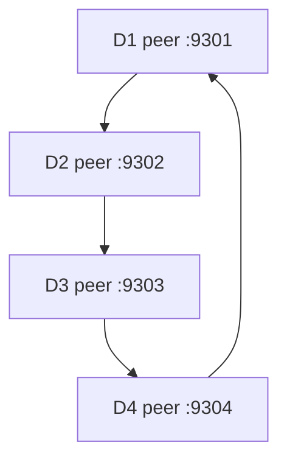

# Distributed Ride Matching — Milestone 3

This version adds a peer-to-peer driver discovery ring to the Milestone 2 ride-matching app. Each driver runs both its existing HTTP assignment service and a TCP peer node. The matching service discovers live drivers by sending a lookup into the peer ring; it does not use its registration table to choose a driver. Milestone 2's request/reply, JSON marshalling, event broker, two subscribers, and driver group messages are retained.

## Set up in VS Code on Windows

1. Put this `README.md` in the same folder as the Python files, for example `C:\src\projects\327 M3`. Open that folder with **File → Open Folder** in VS Code. Make sure `matching_service.py` and `peer_overlay.py` appear in the Explorer beside this README.
2. Install Python 3.10 or newer and VS Code's Python extension, if needed. Python 3.14.7 has been tested. Open **Terminal → New Terminal**. The commands below assume a PowerShell terminal opened in the folder containing the Python files. Check with `py --version` and `Get-Location`.
3. No third-party packages are needed. All imports use Python's standard library; there is no `pip install` step.
4. Use a **separate VS Code terminal** for each long-running command below. Open another with the **+** button in the terminal panel. Check that each terminal's working directory is the project folder. If PowerShell starts elsewhere, run `cd 'C:\src\projects\327 M3'` (adjust the path if you stored the Python files somewhere else).

Use `python3` instead of `py` on macOS/Linux. Use the exact peer ports shown here unless you configure `PEER_SEEDS` in the matching service's environment.

## Start the demo

Start these in separate terminals, in order. Keep each command running:

| Terminal | Command | Purpose |
| --- | --- | --- |
| 1 | `py event_broker.py` | TCP topic and group broker on 9200 |
| 2 | `py matching_service.py` | HTTP matching service and browser UI on 9000 |
| 3 | `py subscriber.py audit` | First `ride.assigned` subscriber |
| 4 | `py subscriber.py monitor` | Second `ride.assigned` subscriber |
| 5 | `py driver_service.py D1 9101 37.770 -122.410 drivers.local 9301` | First driver and peer; starts the ring |
| 6 | `py driver_service.py D2 9102 37.790 -122.420 drivers.local 9302 127.0.0.1:9301` | Second driver joins D1 |
| 7 | `py driver_service.py D3 9103 37.760 -122.400 drivers.local 9303 127.0.0.1:9301` | Third driver joins D1 |

Leave D4 stopped initially to show an actual join. In a short-lived extra terminal, run:

```powershell
py peer_client.py status
```

The `members` list should contain D1, D2, and D3. Now start D4 in terminal 8:

```powershell
py driver_service.py D4 9104 37.780 -122.430 drivers.local 9304 127.0.0.1:9301
```

Run `py peer_client.py status` again. The list now contains D1–D4. Run `py peer_client.py status 127.0.0.1:9304` to see D4's view. Each peer knows the sorted member list and its two ring neighbors; it stores its own driver location and availability.

## Reproduce the required behavior

Use another short-lived terminal for commands. Browser: [http://localhost:9000/](http://localhost:9000/).

| Action | Command or UI step | What to check |
| --- | --- | --- |
| Routed lookup and resource discovery | `py peer_client.py lookup D3` | `path` lists `D1`, `D2`, `D3`; `resources` contains D3's address and location. Peer terminals/logs show `LOOKUP`, `FORWARD`, `FOUND`. |
| All four peers | `py peer_client.py scan` | Four driver resources and a path through D1–D4. |
| Rider request/reply | `py rider_client.py John 37.775 -122.415 req-john` or press **Send New Request** in the UI | A JSON `matched` response; matching service logs a peer lookup and the chosen driver accepts `/assign`. D1 should be nearest for the command shown. |
| Duplicate request | Rerun the exact John command or press **Retry Same (Duplicate)** in the UI | Same response for the same request ID; one assignment. |
| Pub/sub | After a successful match, inspect terminals 3 and 4 | Both subscribers print a `ride.assigned` notification. |
| Group message | `py group_client.py drivers.local "High demand: update your location"` | Response says `recipients: 4` if all four drivers are still connected; group logs appear in their terminals. |
| Clean departure | Press **Ctrl+C** in D4's terminal, then run `py peer_client.py status` | Membership becomes D1, D2, D3. D4 sends `LEAVE`, and neighbors update. |
| Peer crash and recovery | In D2's terminal, find the printed `PID`; in another PowerShell terminal run `Stop-Process -Id <D2_PID> -Force` with the actual number, then run `py peer_client.py lookup D3` | The lookup detects D2's failed TCP hop, removes D2, and reaches D3 along `D1`, `D3`. Confirm with `py peer_client.py status`. |
| Match after failure | `py rider_client.py Emma 37.760 -122.400 req-emma` | D3 accepts Emma's ride; available live peers remain discoverable. |
| Marshalling | `py demo_marshall.py` | A Python dict, its JSON UTF-8 bytes, and the reconstructed dict. The matching terminal also prints received and outgoing wire bytes during HTTP requests. |

**PowerShell note:** `<D2_PID>` is a placeholder; type the actual number without angle brackets. `Stop-Process -Force` is only for the crash demonstration. For normal shutdown use **Ctrl+C**, which sends a graceful peer leave. If `recipients` is less than 4 immediately after startup, wait a second for the driver's broker connections and retry the group message.

To start with clean logs, stop all long-running commands with Ctrl+C, run `py clean_logs.py` in the project folder, and restart in the order above. `logs/` is created automatically. To inspect evidence in PowerShell:

```powershell
Get-Content .\logs\driver-D1-peer.log
Get-Content .\logs\matching-service.log
Get-Content .\logs\broker.log
```

## Network and message design



Peers are ordered by driver ID; `JOIN` copies the bootstrap peer's membership and announces the new peer, `LEAVE` removes a departing peer, and `REMOVE` propagates a failed peer's removal. A `LOOKUP` is forwarded over TCP to the next live successor. A `find` stops when the target owner replies; `scan` gathers resources from every visited owner. The `path` in the response and timestamped peer logs show the actual route. An unreachable next hop is removed when a lookup tries to contact it, and lookup continues to the next peer. This is a small, successor-routed ring, not a hash based DHT. A missing owner cannot provide its resource.

Peer messages are UTF-8 JSON followed by a newline. For example, `{"op":"LOOKUP","kind":"find","target_id":"D3","query_id":"...","path":[],"ttl":32,"trace":true}`. `JOIN`, `ANNOUNCE`, `LEAVE`, `REMOVE`, `LOOKUP`, `STATUS`, and `UPDATE_LOCATION` use the same framing. The matching service's HTTP JSON request/reply and the TCP broker's pub/sub and named group events continue from Milestone 2. The broker sends live events only; subscription and matching state are in memory. The peer overlay does not persist or replicate individual driver resources, and crashed owners are removed on a subsequent lookup.

## Files and ports

| File | Role |
| --- | --- |
| `peer_overlay.py`, `peer_client.py` | TCP ring, membership, lookup, and command-line inspection |
| `driver_service.py` | Driver HTTP service, own peer node, broker group listener |
| `matching_service.py`, `rider_client.py` | HTTP ride matching and client; discover live drivers through peer lookup |
| `event_broker.py`, `messaging.py` | TCP pub/sub and group delivery |
| `subscriber.py`, `group_client.py` | Notification receivers and group message sender |
| `demo_marshall.py`, `clean_logs.py` | Serialization demo and log reset |

Default ports: matching HTTP `9000`; broker TCP `9200`; driver assignment HTTP `9101–9104`; driver peer TCP `9301–9304`. The drivers must have distinct HTTP and peer ports. The demo uses `127.0.0.1`, so all processes run on one computer as separate nodes. `MATCHING_PORT`, `BROKER_PORT`, and `PEER_SEEDS` can override the default service ports/seeds for local testing; if you change a driver port, update its arguments and the matching service's seeds accordingly.
